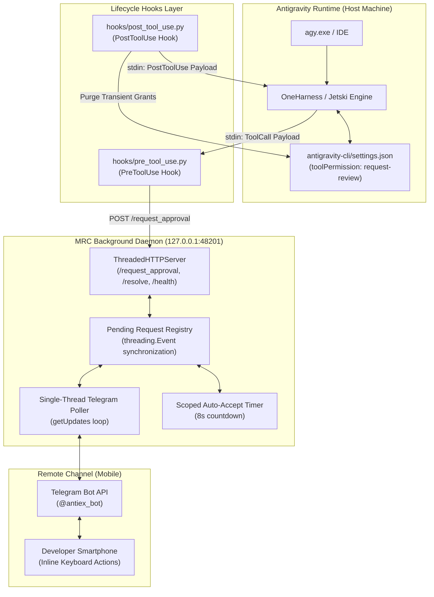
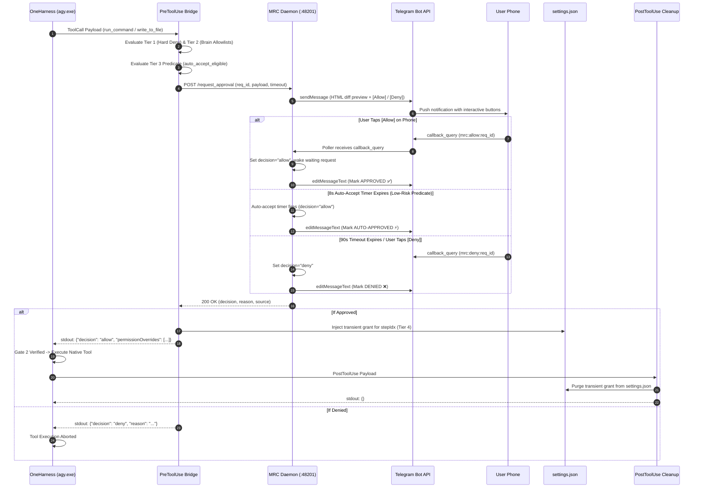

# Mobile Remote Control (MRC): System Architecture

## 1. System Overview

Mobile Remote Control (MRC) bridges Antigravity's local agent execution runtime (`agy.exe` / `Jetski`) with remote communication channels (Telegram, Discord) to allow developers to safely monitor, inspect, and authorize tool calls while away from their workstation (AFK).



---

## 2. Sequence Diagram: Tool Authorization Lifecycle



---

## 3. Four-Tier Policy Evaluation

MRC enforces security decisions through four strictly ordered tiers:

```
+-------------------------------------------------------------+
| Tier 1: Inviolable Hard Deny                                |
| - Blocks ~/.gemini/**, hooks.json, settings.json            |
| - Blocks credentials (.ssh, .aws, .env)                     |
| - Blocks git push --force, git reset --hard, git clean -fd  |
+-------------------------------------------------------------+
                              | (If not blocked)
                              v
+-------------------------------------------------------------+
| Tier 2: Project-Scoped Allowlists                           |
| - Agent brain artifacts (~/.gemini/.../brain/**) auto-allow |
| - Read-only safe tools proceed frictionless                 |
+-------------------------------------------------------------+
                              | (If not allowlisted)
                              v
+-------------------------------------------------------------+
| Tier 3: Scoped Auto-Accept Predicate                        |
| - Is it a safe inspection command or workspace file edit?   |
|   -> YES: 8s auto-accept countdown engaged                  |
|   -> NO:  90s full human review required                    |
+-------------------------------------------------------------+
                              | (Dispatched to Daemon)
                              v
+-------------------------------------------------------------+
| Tier 4: Remote Authorization & Transient Session Grants     |
| - Out-of-band human confirmation via Telegram / keyboard    |
| - Injects transient grant into settings.json for stepIdx    |
| - Gate 2 satisfied; PostToolUse hook purges grant on exit   |
+-------------------------------------------------------------+
```

---

## 4. Daemon Architecture & Concurrency Mechanics

The daemon ([src/mrc/daemon.py](file:///C:/Users/tongn/.gemini/antigravity/scratch/mrc-prototype/src/mrc/daemon.py)) operates as a standalone multi-threaded HTTP server:

1. **ThreadedHTTPServer**:
   - Subclasses `socketserver.ThreadingMixIn` and `http.server.HTTPServer` so incoming requests (`/request_approval`, `/resolve`, `/health`) are handled concurrently without head-of-line blocking.
2. **Dedicated Poller Thread**:
   - Exactly one long-lived background thread executes Telegram `getUpdates` with long-polling (`timeout=5`).
   - Guarantees zero dropped callbacks and completely prevents Telegram HTTP 409 Conflict errors.
3. **Pending Request Registry**:
   - Requests are stored in a synchronized dictionary indexed by `req_id`:
     ```python
     {
       "req_id": "abc12345",
       "event": threading.Event(),
       "decision": None,
       "source": None,
       "sent_msg_id": 1042
     }
     ```
   - Calling `/resolve` or receiving a Telegram callback query sets `req_entry["decision"]` and calls `req_entry["event"].set()`, terminating the wait in `< 5ms`.
4. **Local Keyboard Interception**:
   - The CLI bridge simultaneously polls `msvcrt.kbhit()` on Windows, allowing the developer at the desk to press `[Y]` to approve locally or `[N]` to deny, resolving the request and editing the Telegram message accordingly.
