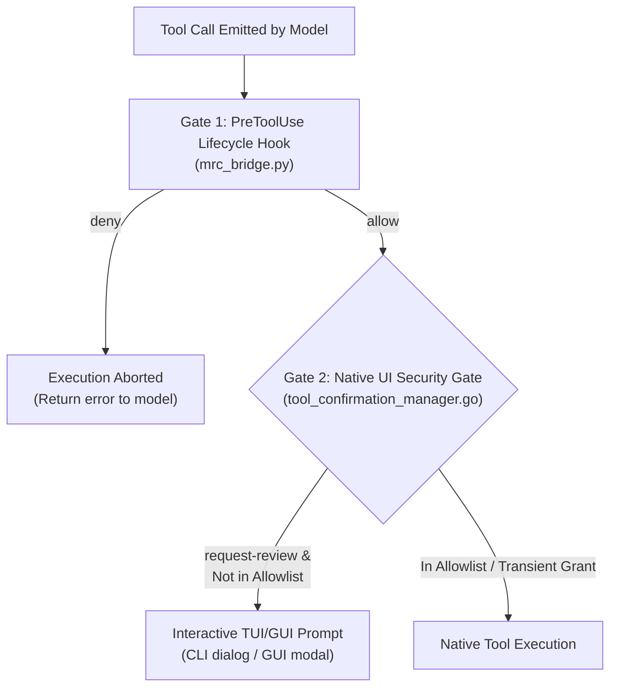

# Mobile Remote Control (MRC): Engineering Progress & Incident Log

## Overview & Status
This document maintains the chronological engineering log, key technical findings, incident root-cause analyses, and milestone completion status for the Mobile Remote Control system.

---

## Chronological Engineering Log

### Incident 1: The Trap of Global Autonomy & Auto-Pilot Side Effect
* **Symptoms**: During early prototype attempts to silence duplicate CLI confirmation dialogs, `agy` suddenly began executing commands without human review (auto-pilot mode).
* **Investigation**:
  - The configuration was set to `"toolExecutionPolicy": "always-proceed"`, which `agy.exe` parsed as `"toolPermission": "always-proceed"`.
  - In addition, `"commandAllowlist": ["*"]` was configured.
  - This globally bypassed all security checks across every tool call, violating Antigravity's core "Always Ask — Human in Control" design.
* **Resolution**:
  - Reverted `settings.json` to `"toolPermission": "request-review"` and removed the wildcard `"*"` from `commandAllowlist`.
  - Formulated [ADR-001](file:///C:/Users/tongn/.gemini/antigravity/scratch/mrc-prototype/docs/ADR-001-guardrail-and-permission-architecture.md), codifying the **Fail-Closed Baseline** and replacing permanent allowlist bypasses with single-use transient session grants.

---

### Technical Finding: The Two-Gate Permission Hierarchy
Through inspection of CLI logs and internal Go runtime errors, we uncovered the two-gate architecture inside `agy.exe`:



1. **Gate 1 (`PreToolUse` Lifecycle Hook)**:
   - External audit and veto point. Returning `{"decision": "allow"}` only indicates the extension has no objection. It does **not** grant session permission to execute in `request-review` mode.
2. **Gate 2 (Native UI Security Gate)**:
   - Enforced by `tool_confirmation_manager.go` in CLI and modal dialogs in GUI when in `request-review` mode.
   - In interactive mode (TUI/GUI), un-allowlisted commands trigger a secondary confirmation dialog.
   - In headless mode (`--print`), un-allowlisted commands fail closed:
     ```
     jetski: no output produced — a tool required the "command" permission that headless mode cannot prompt for, so it was auto-denied.
     ```
3. **Resolution**:
   - Implemented Tier 4 Transient Session Grants in `mrc_bridge.py`: when remote approval is received, inject the command into `settings.json` for the duration of `stepIdx`.
   - Purged immediately upon tool completion via `PostToolUse` (`mrc_cleanup.py`).

---

### Technical Finding: Internal Core Harness vs Public Python SDK
* **Observation**: Traces frequently referenced `cli_setting_manager.go`, `tool_confirmation_manager.go`, `pretoolhook.go`, `OneHarness`, `Jetski`, and `Cortex`.
* **Clarification**:
  - These components belong to Google's internal compiled Go harness powering `agy.exe` and `language_server_windows_x64.exe`.
  - The `google-antigravity-sdk` is strictly an application-level Python library for authoring standalone agents.
  - Lifecycle hooks for `agy` must adhere to the Go harness's protojson contract (`decision`, `reason`, `permissionOverrides`). Custom fields (e.g. `hookSpecificOutput`) cause unmarshaling failures.

---

### Incident 2: Telegram Double-Tap Bug & HTTP 409 Poller Conflict
* **Symptoms**: Tapping `[✅ Allow]` on Telegram often failed to register on the first tap, requiring a second tap, or resulting in dropped updates.
* **Investigation**:
  - Each tool call spawned an ephemeral `mrc_bridge.py` process.
  - On startup, each process called `getUpdates({"offset": -1})` and discarded the returned update to find the latest offset. This discarded pending taps!
  - Concurrent tool calls resulted in multiple processes polling Telegram simultaneously, triggering Telegram Bot API HTTP 409 Conflict errors.
* **Resolution**:
  - Replaced ephemeral pollers with a long-lived, single-thread daemon ([mrc_daemon.py](file:///C:/Users/tongn/.gemini/antigravity/scratch/mrc-prototype/mrc_daemon.py)) running a `ThreadedHTTPServer` on `127.0.0.1:48201`.
  - Exactly one poller thread handles `getUpdates`, ensuring zero dropped updates and zero HTTP 409 conflicts.
  - Added `/resolve` endpoint for instant workstation keyboard resolution (`[Y] / [N]`).

---

### Incident 3: Scoped Auto-Accept Predicate
* **User Requirement**: Enable an 8-second auto-approval timer so AFK developers don't have to unlock their phone for trivial inspection commands, but strictly prevent auto-approving destructive actions.
* **Design & Implementation**:
  - Defined the Tier 3 Risk Classifier predicate (`is_eligible_for_auto_accept`):
    - **Eligible (8s countdown)**: Non-destructive workspace file edits, read-only inspection commands (`git status`, `git diff`, `npm test`, `pytest`, `flutter test`, `fvm dart format`).
    - **Ineligible (90s review)**: Shell commands matching destructive patterns, root project manifests (`package.json`, `pubspec.yaml`, `pyproject.toml`), out-of-workspace file edits.
  - Updated `mrc_daemon.py` to check `auto_accept_eligible` in the request body, omitting countdown text and honoring the full 90s window for high-risk operations.

---

---

### Incident 4: Duplicate GUI Approval Prompt on Remote Allow
* **Incident Description**:
  - Remote mobile approval succeeded on Telegram, but the Antigravity desktop Electron UI still displayed a tool confirmation review card, requiring a second manual approval on the host machine.
* **Investigation**:
  - When the hook outputted `{"decision": "allow", "permissionOverrides": ["command(...)"]}`, the internal Go harness interpreted `permissionOverrides` as a requested elevation rather than a settled authorization.
  - The internal schema notes that `permissionOverrides` is only evaluated when `decision == "ask"`.
* **Resolution**:
  - Modified [pre_tool_use.py](file:///C:/Users/tongn/.gemini/antigravity/scratch/mrc-prototype/hooks/pre_tool_use.py) so that `permissionOverrides` is strictly suppressed when `decision == "allow"`.
  - Re-tested with live Telegram button tap: affirmative denial immediately aborted with zero GUI prompt; remote allow executed directly.

---

## Milestone 1 Verification Matrix

| Verification Target | Test Method | Outcome | Status |
| :--- | :--- | :--- | :--- |
| **Tier 1: System Config Protection** | Mock edit to `hooks.json` & `settings.json` | Blocked with `{"decision": "deny"}` | ✅ PASSED |
| **Tier 1: Credential Protection** | Mock edit to `.aws/credentials` & `.env` | Blocked with `{"decision": "deny"}` | ✅ PASSED |
| **Tier 1: Destructive Git Commands** | Mock `git push --force`, `git reset --hard`, `git clean -fd` | Blocked with `{"decision": "deny"}` | ✅ PASSED |
| **Tier 2: Agent Brain Artifacts** | Write to `~/.gemini/.../brain/**` | Auto-approved | ✅ PASSED |
| **Tier 3: Safe Command Auto-Accept** | `git status`, `fvm flutter test`, `npm test` | Classified eligible for 8s timer | ✅ PASSED |
| **Tier 3: Destructive Command Review** | `Remove-Item`, `npm publish`, root manifest edits | Classified ineligible; 90s timer | ✅ PASSED |
| **Tier 4: Transient Session Grants** | Injected grant into `settings.json` for `stepIdx` | Successfully satisfied Gate 2 | ✅ PASSED |
| **Tier 4: PostToolUse Cleanup** | Trigger `post_tool_use.py` | Grant purged from `settings.json` & grants file removed | ✅ PASSED |
| **Modular SRP Unit Suite** | `python -m unittest discover -s tests -v` | 10/10 tests passed in 0.020s | ✅ PASSED |
| **Legacy Compatibility Suite** | `test_suite_m1.py` unit suite | 3/3 tests passed in 0.043s | ✅ PASSED |
| **GUI Double-Prompt Suppression** | Suppressed `permissionOverrides` on `allow` | Pure `decision: "allow"` emitted | ✅ PASSED |
| **Live Remote Telegram Interception** | Real-time tool push & mobile `[Deny]` tap | Executed abort with zero GUI prompt | ✅ PASSED |
| **CLI Runtime Integrity** | `agy --version` & `agy --print "Say Hello M1"` | Executed cleanly; exit code 0 | ✅ PASSED |
| **Settings Integrity** | Check `settings.json` | Maintained `toolPermission: "request-review"` | ✅ PASSED |
| **Git Save-Point** | Commit `ed27021` on `main` | Modular package, ADRs & docs committed | ✅ PASSED |

