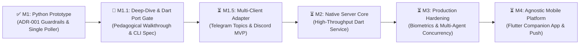

# Mobile Remote Control (MRC): High-Level Model & Evolutionary Roadmap

## 1. Vision & Core Philosophy

Mobile Remote Control (MRC) turns your personal smartphone (via Telegram/Discord) into an out-of-band authorization terminal for Google Antigravity (`agy` CLI & GUI). 

### Core Architectural Invariants:
1. **"Always Ask — Human in Control"**: Fail-closed is the fundamental security posture (`toolPermission: "request-review"`). Remote interaction provides convenient out-of-band triage when AFK, never unconstrained auto-pilot.
2. **Two-Gate Harmony**: Remote approvals clear both Gate 1 (extension hook audit) and Gate 2 (native UI confirmation gate) without permanent wildcard bypasses.
3. **Provider-Agnostic Abstraction**: The core daemon communicates via the **Universal Agent-Bridge Interface (UABI)**. Communication providers (Telegram, Discord, Web Push) are swappable adapters.

---

## 2. Evolutionary Milestones



### Milestone Summary:

| Milestone | Stage | Tech Stack | Primary Objective | Status |
| :--- | :--- | :--- | :--- | :--- |
| **M1** | Antigravity Plugin Release (v0.1.0) | Python 3 (stdlib) | Official Antigravity plugin manifest, `/mrc` MCP management, Cloud Remote URL bridge, chat-scoped hands-free mode, 38 unit tests. | ✅ **COMPLETED** |
| **M1.1** | Architecture & Dart Port Gate | Python -> Dart | Pedagogical walkthrough, formal UABI spec, compiled Dart daemon port for zero-runtime dependencies and high performance. | 🔄 **CURRENT** |
| **M1.5** | Multi-Client Adapter | Dart / Python | Support multi-agent sessions via Telegram Forum Topics and Discord Channels/Threads. Client-agnostic event model. | ⏳ Planned |
| **M2** | Native Server Core | Compiled Dart | Production-grade background service (Windows Service / systemd), structured IPC, bidirectional streaming. | ⏳ Planned |
| **M3** | Enterprise Hardening | Dart / Rust | E2E encryption, biometrics approval (FaceID/Fingerprint), multi-session concurrency leasing, token auditing. | ⏳ Planned |
| **M4** | Mobile Platform | Flutter | Dedicated Flutter iOS/Android companion app with WebSockets, native OS push notifications, full TUI mirror. | ⏳ Planned |

---

## 3. Milestone Details

### Milestone 1: Python Prototype (Completed)
- Implemented ADR-001 Hybrid Ask-First Guardrails.
- Replaced buggy multi-poller architecture with single-thread background poller in `mrc_daemon.py`.
- Solved double-tap bug and eliminated duplicate CLI/GUI confirmation dialogs.
- Created Scoped Auto-Accept Predicate (8-second countdown for low-risk actions; 90-second timeout for mutating commands).
- Built automated regression test suite (`test_suite_m1.py`).

### Milestone 1.1: Pedagogical Deep-Dive & Dart Port Graduation Gate (Current)
- Complete codebase refactoring into an idiomatic package structure adhering to Single Responsibility Principle (SRP) (`src/mrc/`, `hooks/`, `tests/`).
- Formalize the Universal Agent-Bridge Interface (UABI) DTOs and JSON Schemas.
- Compile initial Dart CLI / daemon port (`bin/mrc.dart`), validating performance benefits (sub-5ms startup, zero Python environment drift).

### Milestone 1.5: Multi-Client Provider MVP (Telegram Topics + Discord)
- Map agent sessions to separate communication channels:
  - **Telegram**: Forum Topics (`message_thread_id`) per agent workspace/conversation.
  - **Discord**: Text channels and threads with interactive ActionRow buttons (`type: 2`).
- Establish a uniform `ProviderAdapter` interface:
  ```
  dispatch(NotificationPayload) -> ChannelMessageRef
  onAction(CallbackQuery | Interaction) -> DecisionResult
  ```

### Milestone 2: Native Server Core (Compiled Dart)
- Compile standalone native executable (`mrc.exe` / `mrc`) with zero interpreter dependencies.
- Embed native OS notifications (Windows Action Center toast notifications, macOS notifications).
- High-throughput asynchronous HTTP/IPC server handling multi-agent bursts without event loop blocking.

### Milestone 3: Hardened Enterprise Security
- Implement cryptographic session signing (HMAC-SHA256) between agent hooks and daemon.
- Integrate WebAuthn / Biometrics for mobile approvals (Apple FaceID, Android BiometricPrompt).
- Add strict resource quotas and token spend thresholds.

### Milestone 4: Native Flutter Companion App
- Transition from third-party chat bots (Telegram/Discord) to a dedicated, branded Flutter app.
- Real-time syntax-highlighted diff rendering with tree-view file navigation.
- Full offline queuing and encrypted peer-to-peer relay.
